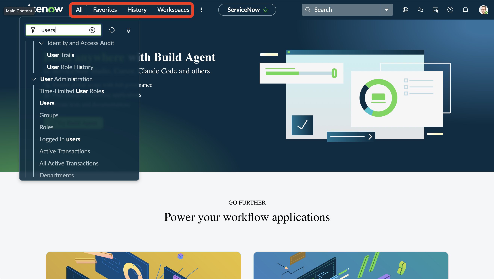
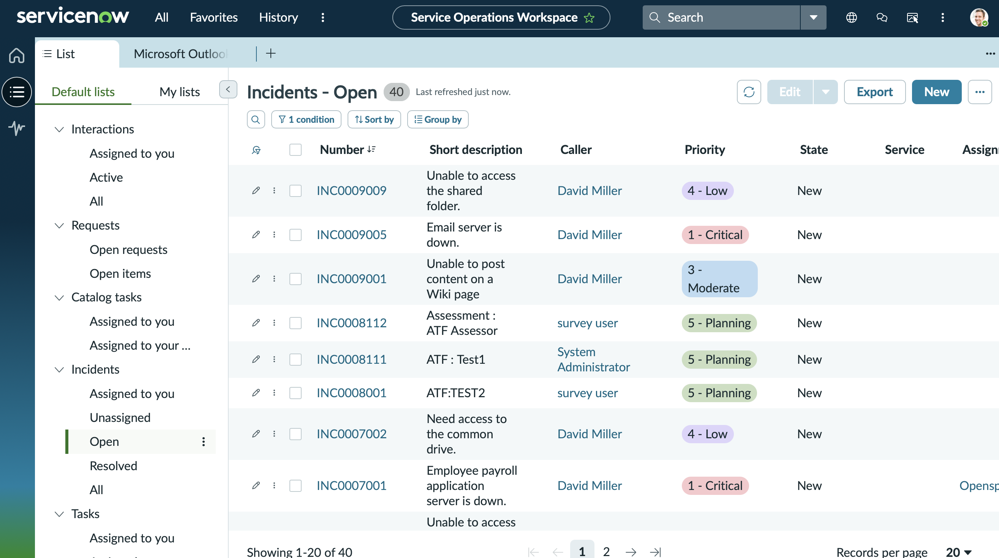
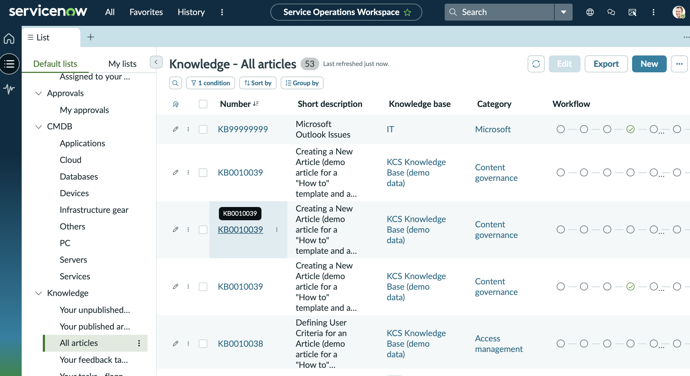

# Project 10: ServiceNow Incident Management & Service Catalog Lab

## Objective
Get familiar with ServiceNow ITSM workflows on a Personal Developer Instance to understand how an IT service desk handles IT incidents and requests. 

## Tools & Technologies
- ServiceNow PDI
	- User Administration
	- Incident Management
	- SLA Management 
	- Service Catalog

## Steps Taken

### Exploring The Dashboard 
Before building anything, I explored the instance to understand how ServiceNow is organised and where each part of the ITSM lifecycle lives.

#### 1. Navigating the Instance
The **All** menu opens the application navigator which groups the platform into applications and modules and can be filtered by name. **Workspaces** gives access to role-based dashboards. 

#### 2. Service Operations Workspace
Service Operations Workspace is ServiceNow's interface for service desk staff handling tickets. The widgets show my incidents, SLAs, unassigned incidents and catalog tasks, split into "Your work" and "Your team's work". It is currently empty as nothing has been raised yet.

##### Open Incidents
Shows open IT incident tickets and their priority from customers that need to be resolved by the IT helpdesk. For example 'Unable to access the shared folder' with a 'low' priority.

##### Resolved Incidents
Where tickets solved by the helpdesk are. Its a good place to check whether a the issue has already been fixed so the fix can be reused.

##### Knowledge Articles
The help desk's library of troubleshooting guides. They attach articles to incidents, and users can self-serve from them. Example: the Microsoft Outlook Issues article (demo data)

## Outcome
Successfully deployed and secured a cloud VM, and gained a working understanding of how Azure handles resource grouping, VM provisioning, and network-level access control via NSGs.

## What I'd Do Next
- Automate this deployment using Azure CLI or an ARM/Bicep template instead of the portal UI
- Set up Azure Monitor/alerts on the VM
